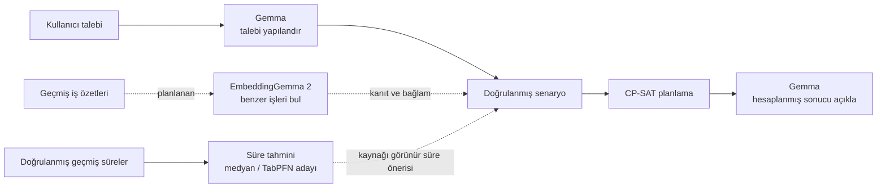
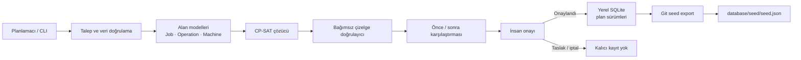
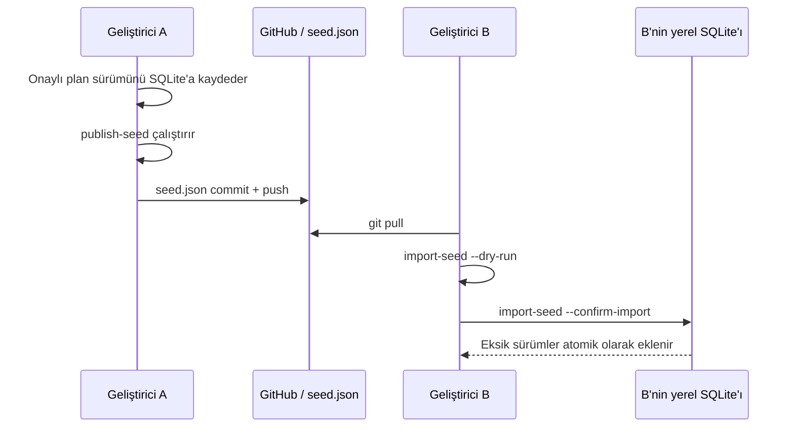
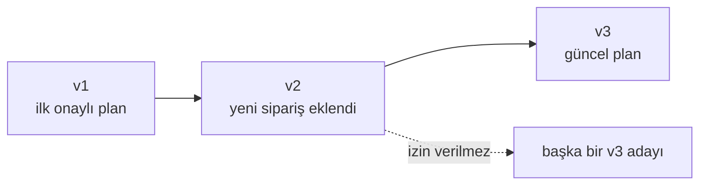

# Türkçe Üretim Planlama ve Sipariş Değerlendirme

Türkiye'deki fason imalat atölyeleri için geliştirilen, yerelde çalışabilen
üretim planlama prototipi. Proje; mevcut plana yeni bir sipariş eklendiğinde
işin ne zaman biteceğini, hangi mevcut işlerin etkileneceğini ve doğrulanmış
alternatif makinelerin sonucu değiştirip değiştirmediğini hesaplar.


## Projenin cevapladığı soru

> Bu yeni siparişi mevcut plana eklersem ne zaman biter, hangi işler gecikir ve
> uygun başka bir makine kullanmak sonucu değiştirir mi?

Çekirdek akış:

1. Benchmark veya atölye senaryosunu tipli modellere dönüştürür.
2. OR-Tools CP-SAT ile makine ataması ve zaman çizelgesi üretir.
3. Sonucu çözücüden bağımsız kurallarla yeniden doğrular.
4. Yeni siparişi mevcut planı değiştirmeden simüle eder.
5. Önce/sonra makespan, termin ve etkilenen iş metriklerini hesaplar.
6. Kullanıcı tarafından seçilen planı yeni ve değiştirilemez bir sürüm olarak saklar.

## Sistem nasıl çalışır?

Örnek kullanıcı isteği:

> “Yeni sipariş için önce tornalama, sonra taşlama yapılacak. Sipariş yarın
> bitmeli. Uygun başka makine daha erken bitiriyorsa onu da karşılaştır.”

Sistem bu isteği aşağıdaki aşamalardan geçirir:


Bu akışta görev sınırları nettir:

- **Gemma**, Türkçe talebi yapılandırır, eksik bilgiyi sorar ve hesaplanmış
  sonuçları açıklar. Makine uygunluğu, işlem süresi veya çizelge saati uydurmaz.
- **Pydantic modelleri**, kimlikleri, süreleri, makine seçeneklerini, terminleri
  ve operasyon durumlarını doğrular.
- **CP-SAT**, doğrulanmış seçenekler arasından çizelgeyi hesaplar.
- **Bağımsız doğrulayıcı**, çözücünün sonucunu makine çakışması, süre ve öncül
  ilişkileri açısından tekrar denetler.
- **İnsan onayı**, simülasyon ile kalıcı plan arasındaki zorunlu kapıdır.

Bugün operasyon süresi varsayılan olarak kullanıcı tarafından doğrulanmış,
benchmarktan gelmiş veya açıkça demo varsayımı olarak etiketlenmiş değerdir.
Gelecekteki makine öğrenmesi katmanı doğrudan planı değiştirmeyecek; süre önerisi
üretecek, kaynağını gösterecek ve kullanıcı onayı/fallback sonrasında CP-SAT'a
girdi sağlayacaktır.

## Güncel kapsam

| Alan | Durum | Açıklama |
| --- | --- | --- |
| FJSP benchmark | Çalışıyor | Brandimarte Mk01–Mk10 parser, CP-SAT, referans yöntem ve Gantt çıktısı |
| Atölye planlama | Çalışıyor | Alternatif makine, makineye bağlı süre, hazır olma, sert termin ve duruş |
| Devam eden işler | Çalışıyor | Başlamış/tamamlanmış operasyonlar ve geçmiş zaman korunuyor |
| Yeni sipariş | Çalışıyor | Başlangıç planını değiştirmeyen simülasyon ve önce/sonra karşılaştırması |
| Plan sürümleri | Çalışıyor | Pydantic doğrulama, SQLite, parent kontrolü ve atomik kayıt |
| Ekip veri paylaşımı | Çalışıyor | Onaylı sürümlerin Git seed dosyasıyla paylaşılması |
| Gemma | Mevcut, deneysel | Türkçe talep yapılandırma, takip sorusu ve hesaplanan sonuç açıklaması |
| Süre tahmini | Altyapı mevcut | Veri denetimi, özellik çıkarımı ve medyan referansı var; operasyonel ML modeli henüz bağlı değil |
| EmbeddingGemma 2 | Planlandı | Geçmiş iş özetlerinden kanıtlı benzer kayıt araması henüz uygulanmadı |
| Streamlit arayüzü | Eklendi(geliştiriliyor)| Çekirdek ve CLI arayüzden bağımsız çalışıyor |

## Yapay zekâ ve makine öğrenmesi katmanları

Proje tek bir modele bağımlı değildir. Her yapay zekâ bileşeni farklı ve sınırlı
bir sorumluluk taşır:



### Gemma — mevcut deneysel katman

- Türkçe talebin sipariş, operasyon, makine, süre ve termin alanlarını çıkarır.
- Eksik veya belirsiz alanlarda takip sorusu üretir.
- Kullanıcı taslağı ayrıca onayladıktan sonra simülasyon aracını seçer.
- CP-SAT tarafından hesaplanan bulgulardan Türkçe açıklama üretir.
- Model kullanılamazsa manuel giriş ve güvenilir şablon açıklaması devam eder.

### EmbeddingGemma 2 — planlanan katman

- Yeni sipariş metnine benzeyen geçmiş iş emri/operasyon özetlerini arayacak.
- İlk hedef, en benzer birkaç kaydı kaynak kimliği ve kanıt metniyle göstermektir.
- Benzerlik sonucu makine uygunluğunun veya işlem süresinin doğruluğunun kanıtı
  sayılmayacaktır.
- Gelecekteki/test dönemindeki kayıtlar arama indeksine sızdırılmayacaktır.
- Arama sonucu kullanıcıya bağlam sağlar; çizelgeyi kendiliğinden değiştirmez.

### Süre öğrenimi — altyapı mevcut, model entegrasyonu planlandı

Şu anda veri şeması, kronolojik ve iş-emri ayrık değerlendirme kontrolleri,
eğitim verisinden hesaplanan operasyon medyanı, özellik seçimi ve nedensel özellik
çıkarma hattı vardır. TabPFN ağırlıkları indirilmiş veya operasyonel planlamaya
bağlanmış değildir.

Planlanan değerlendirme:

1. Süre hedefinin `recorded_elapsed_minutes` mı yoksa insan tarafından
   doğrulanmış net işlem süresi mi olduğu kesinleştirilecek.
2. Aynı iş emri eğitim ve test arasında bölünmeyecek; gelecek bilgisi özelliklere
   sızdırılmayacak.


## Geliştirme yol haritası

| Aşama | Hedef | Durum |
| --- | --- | --- |
| 1. Planlama çekirdeği | FJSP okuma, CP-SAT, bağımsız doğrulama, Gantt | Çalışıyor |
| 2. Sipariş senaryosu | Yeni sipariş, termin, alternatif makine, önce/sonra | Çalışıyor |
| 3. Plan kalıcılığı | SQLite sürümleri ve Git seed paylaşımı | Çalışıyor |
| 4. Türkçe yardımcı | Gemma talep yapılandırma ve sonuç açıklama | Mevcut, genişletilecek |
| 5. Süre öğrenimi | Medyan–TabPFN/uygun regresyon karşılaştırması, fallback ve kaynak görünürlüğü | Altyapı mevcut, modeller bekliyor |
| 6. Geçmiş iş araması | EmbeddingGemma 2 ile kanıtlı benzer kayıtlar | Planlandı |
| 7. Ürün arayüzü | Streamlit, çift Gantt, etkilenen işler ve onay ekranı | Planlandı |
| 8. Genişletmeler | Vardiya/mola, malzeme, fason dönüşü, sıra bağımlı hazırlık | Sonraki aşama |

Temel planlama akışı Gemma, EmbeddingGemma 2 veya süre modeli erişilemediğinde de
manuel ve kullanıcı onaylı girdilerle çalışmaya devam edecektir.

## Mimari



Sorumluluklar birbirinden ayrıdır:

- `core/domain_rules.py`: makine, iş, operasyon ve senaryo sözleşmeleri.
- `core/cpsat_solver.py`: benchmark ve atölye çözücü adaptörü.
- `core/validation.py`: çözücüden bağımsız çizelge kontrolü.
- `core/scenarios.py`: yeni sipariş simülasyonu ve karşılaştırma.
- `core/sqlite_repository.py`: onaylı ve değiştirilemez plan sürümleri.
- `core/plan_exchange.py`: SQLite ile Git seed arasındaki doğrulanmış alışveriş.
- `core/llm/`: deneysel Gemma talep ve açıklama servisleri.

## Hızlı kurulum — Windows PowerShell

Python 3.11 kullanın. Komutları proje kökünde çalıştırın.


### 1. Sanal ortamı ve bağımlılıkları hazırlayın

```powershell
python -m venv .venv
.\.venv\Scripts\python.exe -m pip install -r requirements-lock.txt
```

### 2. Yerel veritabanını oluşturun

```powershell
.\.venv\Scripts\python.exe -m benchmarks.plan_storage_cli --db database/local/production_planning.sqlite3 init
```

Bu komut `database/schema.sql` şemasından kişisel geliştirme veritabanını
oluşturur. Dosya Git'e eklenmez.

### 3. Kontrolleri çalıştırın

```powershell
.\.venv\Scripts\python.exe -m pytest -q tests
.\.venv\Scripts\ruff.exe check core benchmarks ml_experiments tests
```

## Ekip içinde plan verisi paylaşımı

Bu bölüm, geliştiricilerin mutlaka izlemesi gereken veri iletişim akışıdır.

### Üç farklı dosyanın görevi

| Konum | Görev | GitHub'a gönderilir mi? |
| --- | --- | --- |
| `database/schema.sql` | Tablo yapısını tanımlar | Evet |
| `database/seed/seed.json` | Onaylanmış ortak plan sürümlerini taşır | Evet |
| `database/local/production_planning.sqlite3` | Geliştiricinin yerel çalışma veritabanıdır | Hayır |

SQLite dosyası binary olduğu için iki kişinin değişikliklerini Git güvenli
şekilde birleştiremez. `seed.json` metindir, Pydantic ile doğrulanır ve yalnız
onaylı plan sürümlerini taşır. Taslak simülasyonlar seed'e yazılmaz.

### Senkronizasyon nasıl çalışır?



GitHub'dan `pull` yapmak SQLite'ı kendiliğinden güncellemez. Pull sonrasında
`import-seed` komutunun ayrıca çalıştırılması gerekir.

### Çalışmaya başlamadan önce

```powershell
git pull
.\.venv\Scripts\python.exe -m benchmarks.plan_storage_cli --db database/local/production_planning.sqlite3 import-seed --seed database/seed/seed.json --dry-run
.\.venv\Scripts\python.exe -m benchmarks.plan_storage_cli --db database/local/production_planning.sqlite3 import-seed --seed database/seed/seed.json --confirm-import
```

- `--dry-run`, eklenecek sürümleri gösterir ve veritabanını değiştirmez.
- `--confirm-import`, eksik sürümleri parent sırasıyla ekler.
- Aynı import tekrar çalıştırılabilir; mevcut aynı kayıtlar çoğaltılmaz.
- Birden fazla eksik sürüm tek transaction içinde kaydedilir; hata olursa zincir
  yarım bırakılmaz.

### Onaylı planı ekiple paylaşma

Önce plan yerel SQLite'a onaylı sürüm olarak kaydedilmiş olmalıdır. Ardından:

```powershell
.\.venv\Scripts\python.exe -m benchmarks.plan_storage_cli --db database/local/production_planning.sqlite3 publish-seed --seed database/seed/seed.json --plan-id PLAN_ID --confirm-publish
git add database/seed/seed.json
git commit -m "Add approved plan version"
git push
```

`PLAN_ID` yerine paylaşacağınız gerçek plan kimliğini yazın. `publish-seed`:

- Güncel onaylı sürümü ve seed'de bulunmayan parent sürümlerini ekler.
- Daha önce yayımlanmış sürümü değiştirmez.
- Aynı kimlik farklı içerikle gelirse işlemi durdurur.
- Yalnız seed dosyasını hazırlar; sizin yerinize `git commit` veya `git push` yapmaz.

Belirli bir eski sürümü yayımlamak gerekirse `--version VERSION_ID` eklenebilir.

### Sürüm zinciri ve çakışma davranışı



Her plan doğrusal ilerler:

- İlk sürümde `parent_version_id = null`.
- Sonraki sürümün parent değeri o anda güncel olan sürümdür.
- `(plan_id, version_id)` benzersizdir ve eski sürüm değiştirilemez.
- İki geliştirici aynı parent'tan farklı çocuk üretirse sistem birini sessizce seçmez.
- Böyle bir durumda `git pull` ve `import-seed` yapılır; yeni güncel plan üzerinden
  simülasyon tekrar çalıştırılır ve insan onayı alınır.

### Geliştirici kuralları

1. Yeni plan çalışmasından önce mutlaka pull ve import yapın.
2. `seed.json` dosyasını elle düzenlemeyin; CLI komutlarını kullanın.
3. Taslak, `UNKNOWN`, `INFEASIBLE` veya kullanıcı tarafından seçilmemiş sonucu paylaşmayın.
4. Gerçek müşteri verisi, kişisel veri, anahtar veya yerel model kaydını Git'e eklemeyin.
5. Push reddedilirse önce uzak değişiklikleri alın; aynı plan ayrışmışsa yeniden simüle edin.
6. SQLite dosyasını `git add -f` ile zorla eklemeyin.

Ayrıntılı sözleşme: [Plan veri sözleşmesi](docs/plan-data-contract.md) ve
[Git seed ADR](docs/decisions/008-git-plan-seed-exchange.md).

## Planlama demoları

### Yeni sipariş — önce/sonra

```powershell
.\.venv\Scripts\python.exe -m benchmarks.workshop_order_demo
```

Sentetik girdi `data/examples/order_demo.json`; çıktılar
`results/workshop_order/` altındadır. Demo, başlangıç planını değiştirmeden üç
senaryo üretir: tek makine, alternatif makine ve mevcut bitişleri koruyan sert
kısıt. Sayılar gerçek işletme ölçümü değildir.

Atölye modeli şunları destekler:

- Makineye göre değişen pozitif tamsayı dakika süreleri.
- `release_time`, sert `deadline` ve raporlama amaçlı yumuşak `due_date`.
- Tamamlanmış ve devam eden operasyonların gerçek makine/zamanlarının korunması.
- Makine duruşları ve bölünemeyen operasyonlar.
- `OPTIMAL`, `FEASIBLE`, `INFEASIBLE`, `UNKNOWN` ve `MODEL_INVALID` ayrımı.

### Brandimarte benchmark

```powershell
.\.venv\Scripts\python.exe -m benchmarks.brandimarte_runner --time-limit 10
```


Tek örnek:

```powershell
.\.venv\Scripts\python.exe -m benchmarks.brandimarte_runner --instances Mk01 --time-limit 10 --output results/mk01
```

Başlıca çıktılar:

- `summary.csv`: yöntem, boyut, durum, makespan, bound, süre ve ihlal sayısı.
- `Mk*.json`: tam çizelge, kaynak hash/commit ve çözücü ayarları.
- `*_cp_sat.html`: internet gerektirmeyen Plotly Gantt çıktısı.
- `*_job_order_eft.html`: deterministik job-order/EFT referansı.
=======
CLI süreyi sorar; ardından tamamlanmış taslağı gösterip ayrıca onay ister.
Gerçek tarih dönüşümü yoktur: göreli termin için kullanıcıdan `t=40 dakika`
gibi açık sınır istenir. Duruş doğal dil aracı sonraki aşamadadır;
manuel planlı duruş servisi aşağıdaki bölümde açıklanır.


Benchmark süreleri gerçek dakika değildir; yalnız benchmark zaman birimidir.

## Deneysel Gemma akışı

Gemma planı hesaplamaz. Türkçe talebi yapılandırır, eksik alanlar için soru
sorar, desteklenen aracı seçer ve yalnız hesaplanmış sonucu açıklar. Model
erişilemezse manuel JSON/CLI yolu çalışmaya devam eder.

```powershell
ollama serve
.\.venv\Scripts\python.exe -m benchmarks.gemma_order_cli --baseline results/workshop_order/baseline.json --text "Yeni sipariş: Torna 1 üzerinde tornalama yapacağız."
```

Varsayılan yerel model `gemma4:e2b` olarak yapılandırılmıştır; otomatik model
indirilmez. Taslak ayrı insan onayı olmadan simüle edilmez. Bu deneysel akış
üretim kalitesi veya tamamen çevrimdışı çalışmanın kanıtı değildir.

## Süre tahmini deneyleri

Medyan referansı ve veri sızıntısı kontrolleri:
=======
## Arayüz (WP-1N, WP-2N)

```sh
.venv/bin/streamlit run ui/app.py
```

Plan, Rota onayı, Benchmark ve Hakkında sayfaları. `ui/components.py` tekrar
kullanılan bileşenleri (metrik satırı, Altair Gantt, tablo, kaynak rozetleri,
rota düzenleyici), `ui/pages.py` sayfaları içerir. Gündüz ve gece temaları
`.streamlit/config.toml` içindedir; kullanıcı sağ üstteki ⋮ menüsünden Light,
Dark veya System seçer;
hesaplama mevcut `core` servislerinden gelir. Plan sayfası
`database/local/workshop.sqlite3` içinde `synthetic-workshop` için onaylı sürüm
varsa onu, yoksa kaydedilmemiş demo planı gösterir. Benchmark sayfası
`results/brandimarte/` sonuçlarını okur ve seçilen örneği yeniden çözebilir.

Rota onayı sayfası bir sipariş taslağının işlem sırasını, uygun tezgâhlarını ve
dakika sürelerini düzenletir. Düzenlenen süre `user_input`, düzenlenen rota
`user_proposed` olur; rota yalnız açık onay kutusu ve düğmesiyle
`user_approved` olur ve oturumda saklanır. Rota ve süre kaynakları Plan
tablosunda ve onay ekranında aynı renkli rozetlerle gösterilir. Geçmiş veriden
otomatik rota önerisi henüz yok (WP-2A); retrospektif taslak gelirse uyarıyla
gösterilir. Simülasyon, önce/sonra ve plan kaydetme sonraki pakettir (WP-4N).

## Planlama hattı

`core/pipeline.py` mevcut servisleri tek girişte sıralar: plan → tek değişiklik
(yeni sipariş `simulate_order` veya duruş `simulate_downtime`) → çözüm ve
doğrulama → `dispatch`. `dispatch`, seçilen dakikada her tezgâhın işlediği
operasyonu (`[başlangıç, bitiş)`) ve sıradakini verir; Plan sayfasındaki
"Şu an tezgâhlarda" kartları bunu gösterir. Başlangıç planı değişmez; değişiklik
uygulanamazsa görünüm başlangıç planına döner. Plan yükleme ve onaylı kayıt
çağıranda kalır. Gemma için LangGraph katmanı bu hattı araç olarak kullanacak
şekilde planlandı, henüz eklenmedi.

## Otomatik kontroller (CI)

`.github/workflows/ci.yml` her PR'da ve `main`'e push'ta Python 3.11 ile kaynak
depoyu sabit commit'ten getirir, `requirements-lock.txt` ve Streamlit'i kurar,
`ruff check core benchmarks tests ui`, `pytest tests` ve `tutorials/`
notebook'larını çalıştırır. Streamlit 1.66 `pillow<13` istediği için kurulumda
kilitteki pillow 13 düşürülür. `ml_experiments` biçim uyarıları düzelince
ruff kapsamına eklenmeli.

## Plan kayıt sözleşmesi


```powershell
.\.venv\Scripts\python.exe -m ml_experiments.duration_evaluation --dataset data/examples/duration_experiment_synthetic.json
```

Özellik seçimi/çıkarımı ayrı bağımlılıklarla çalışır:

```powershell
.\.venv\Scripts\python.exe -m pip install -r requirements-features.txt
$env:LOKY_MAX_CPU_COUNT='1'
.\.venv\Scripts\python.exe -m ml_experiments.duration_features
```

Production Analysis ve CNC verileri benchmark/sentetik demo verilerinden ayrı
tutulur. Geçen süre otomatik olarak net makine süresi kabul edilmez; gerçek
hedef anlamı ve kullanım onayı ayrıca doğrulanmalıdır.

## Proje dizinleri

```text
core/                  Planlama, doğrulama, senaryo, kayıt ve Gemma servisleri
benchmarks/            Tekrar çalıştırılabilir CLI ve demo giriş noktaları
database/schema.sql    SQLite tablo sözleşmesi
database/seed/         Git ile paylaşılan onaylı geliştirme planları
database/local/        Git'e girmeyen kişisel SQLite dosyaları
data/examples/         Küçük ve paylaşılabilir sentetik girdiler
ml_experiments/        Süre/veri hazırlama deneyleri
tests/                 Sözleşme, çözücü, kayıt ve paylaşım testleri
docs/                  ADR'ler, veri sözleşmeleri ve doğrulama raporları
results/               Yeniden üretilebilir yerel çıktıların hedefi
```

## Doğruluk ve güvenlik sınırları

- Her uygulanabilir çizelge makine uygunluğu, süre, çakışma, sıra, hazır olma,
  sabit geçmiş ve desteklenen termin/duruş kurallarına göre doğrulanır.
- `FEASIBLE`, optimum kanıtı değildir; `UNKNOWN`, imkânsızlık kanıtı değildir.
- Simülasyon mevcut planı değiştirmez. Yeni sürüm yalnız açık kullanıcı seçimi
  ve kayıt çağrısından sonra oluşturulur.
- `approved_by` ve `approved_at` denetim bilgisidir; kimlik doğrulama sistemi değildir.
- Vardiya/mola, malzeme hazır olma, fason dönüşü ve sıraya bağlı hazırlık temel
  akışın tamamlanmış özellikleri olarak sunulmaz.
- Streamlit arayüzü ve gerçek zamanlı merkezi veritabanı henüz yoktur.

## Kaynak, lisans ve katkı ayrımı

Benchmark kaynağı:
[ai-for-decision-making-tue/Job_Shop_Scheduling_Benchmark_Environments_and_Instances](https://github.com/ai-for-decision-making-tue/Job_Shop_Scheduling_Benchmark_Environments_and_Instances),
sabit commit `d088a26582f5cb79c6b4f2ad94f68ac7c50878cb`.

Kaynak katkısı; Brandimarte girdileri, parser, Job/Operation/Machine/JobShop
yapıları ve FJSP CP-SAT modelidir. Bu projenin katkısı; sıkı girdi denetimi,
atölye sözleşmeleri, deterministik referans, bağımsız doğrulama, sipariş
simülasyonu, sürümlü SQLite kaydı, Git seed alışverişi ve Türkçe deneysel Gemma
akışıdır. Kaynak kod, veri ve model lisansları ayrı değerlendirilmelidir.

Başlangıç noktaları:

- [Depo rehberi](docs/repo-walkthrough-tr.md)
- [Plan veri sözleşmesi](docs/plan-data-contract.md)
- [Sipariş simülasyonu kararı](docs/decisions/003-order-simulation.md)
- [SQLite kararı](docs/decisions/007-sqlite-plan-repository.md)
- [Git seed paylaşım kararı](docs/decisions/008-git-plan-seed-exchange.md)
=======
[CNC hedef tablosunun kontrol raporu](docs/cnc-data-audit.md):
`ml_experiments.cnc_audit` belirtilen Git commit'indeki ham ve hedef CSV'leri
değiştirmeden karşılaştırır. Oturum/bölme, süre hesabı, sensörlerin korunması
ve eksik veri bayrakları kontrol edilir. Bu kalan süre deneyi;
planlamaya bağlı toplam hazırlık tahmini veya fiziksel anlam onayı değildir.

## Ayrı TabPFN deneyleri

İki regresyonun kodu, raporları, sonuçları, testleri ve bağımlılık kilidi
[experiments/tabpfn](experiments/tabpfn/README.md) altında tutulur.
Uygulamanın planlama, Gemma ve SQLite akışı bu paketi import etmez.
İki gerçek v2 doğrulama deneyinde global medyan geçilemedi; ürün akışına
bağlanmadı.


## Planlı makine duruşu

`core.downtime.simulate_downtime` mevcut planı değiştirmeden makine duruşu
ekler, uygun alternatifleri çözer ve mevcut işlerin bitiş/termin etkisini
hesaplar. Başlamış operasyonu kesme/devam ettirme desteklenmez; açıkça
reddedilir. Kaydetme ayrı insan seçimi ve SQLite sürüm kaydı gerektirir.
[Servis sözleşmesi ve sınırlar](docs/downtime-simulation.md).

```sh
.venv/bin/python -m benchmarks.workshop_downtime_demo
```

JSON ve önce/sonra Gantt çıktıları `results/workshop_downtime/` altında.
Gemma doğal dil duruş aracı ve UI bağlantısı henüz yoktur.

