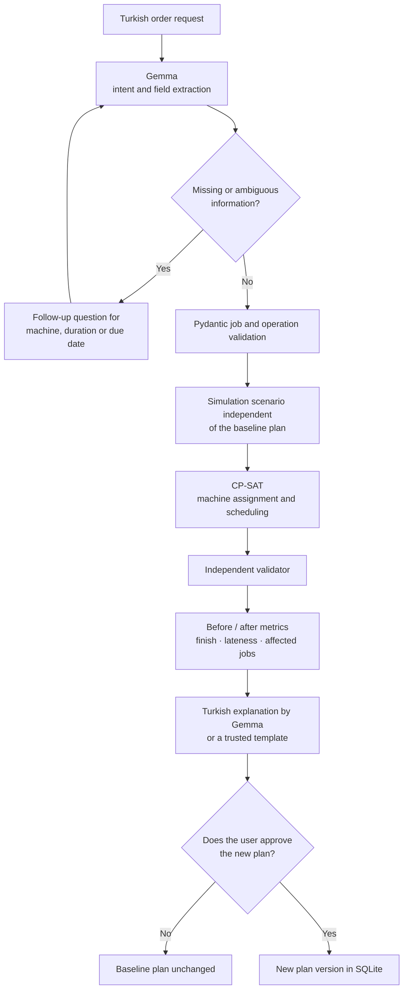
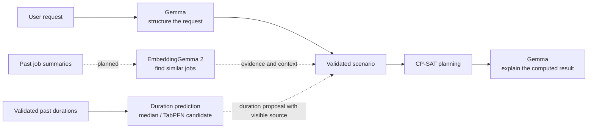
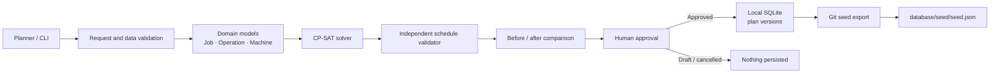
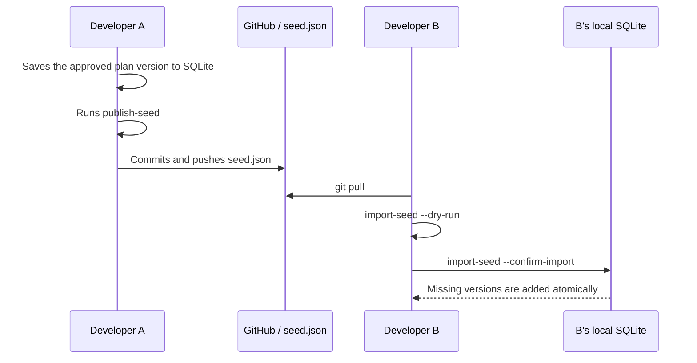
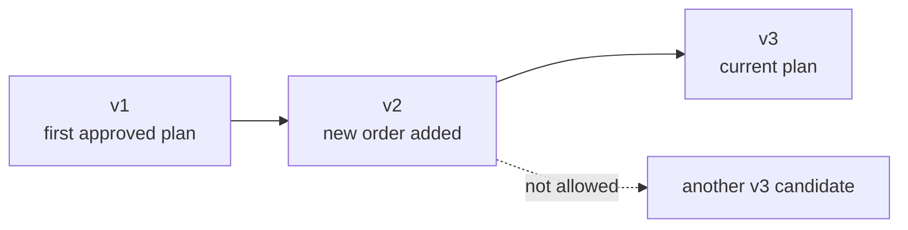

# PickWise — Production Planning and Order Evaluation

A local production planning prototype for contract manufacturing workshops in
Turkey. When a new order is added to the current plan, it calculates when the
order will finish, which existing jobs are affected, and whether a validated
alternative machine changes the result.


## The question the project answers

> If I add this new order to the current plan, when will it finish, which jobs
> will be delayed, and would using another suitable machine change the result?

Core flow:

1. Converts a benchmark or workshop scenario into typed models.
2. Produces machine assignments and a schedule with OR-Tools CP-SAT.
3. Re-validates the result with rules independent of the solver.
4. Simulates the new order without changing the current plan.
5. Calculates before/after makespan, due-date and affected-job metrics.
6. Stores the plan the user selects as a new, immutable version.

## How does the system work?

Example user request:

> "The new order needs turning first, then grinding. It must be finished
> tomorrow. If another suitable machine finishes earlier, compare that too."

The system passes this request through the following stages:



Responsibilities in this flow are clearly separated:

- **Gemma** structures the Turkish request, asks for missing information and
  explains the computed results. It does not invent machine eligibility,
  processing times or schedule times.
- **Pydantic models** validate identifiers, durations, machine options, due
  dates and operation statuses.
- **CP-SAT** computes the schedule from the validated options.
- **The independent validator** re-checks the solver result for machine
  overlaps, durations and precedence relations.
- **Human approval** is the mandatory gate between a simulation and a
  persistent plan.

Today an operation duration is, by default, a value validated by the user,
taken from a benchmark, a historical median, or explicitly labelled as a demo
assumption. A future machine learning layer will not change the plan directly;
it will propose durations, show their source and feed CP-SAT only after user
approval or a fallback.

## Current scope

| Area | Status | Description |
| --- | --- | --- |
| FJSP benchmark | Working | Brandimarte Mk01–Mk10 parser, CP-SAT, reference method and Gantt output |
| Workshop planning | Working | Alternative machines, machine-dependent durations, release times, hard deadlines and downtime |
| Jobs in progress | Working | Started/completed operations and the past are preserved |
| New order | Working | Simulation that leaves the baseline plan unchanged, with before/after comparison |
| Plan versions | Working | Pydantic validation, SQLite, parent check and atomic save |
| Team data sharing | Working | Approved versions shared through a Git seed file |
| Initial plan | Working | Built from 2012 Production Analysis records (10 work orders, 11 machines) |
| Gemma | Available, experimental | Turkish request structuring, follow-up questions, conversational replies and explanation of computed results |
| Duration prediction | Infrastructure available | Data audit, feature extraction and median reference exist; no operational ML model is connected |
| EmbeddingGemma 2 | Planned | Evidence-based search over past job summaries is not implemented yet |
| Streamlit interface | Working | Plan, route approval, simulation, Gemma assistant, benchmark and about pages; the core and CLI also work without it |

## AI and machine learning layers

The project does not depend on a single model. Each AI component has a
different, limited responsibility:



### Gemma — current experimental layer

- Extracts the order, operation, machine, duration and due-date fields from a
  Turkish request.
- Asks follow-up questions for missing or ambiguous fields, one at a time.
- Replies briefly to small talk or off-topic messages and leads back to
  planning; the reply never contains plan figures.
- Selects the simulation tool only after the user separately approves the
  draft.
- Produces a Turkish explanation from the findings computed by CP-SAT.
- If the model is unavailable, manual input and trusted template explanations
  keep working.

### EmbeddingGemma 2 — planned layer

- Will search past work order/operation summaries similar to the new order
  text.
- The first goal is to show the few most similar records with their source ID
  and evidence text.
- A similarity result will not be treated as proof of machine eligibility or
  of an accurate processing time.
- Records from the future/test period will not leak into the search index.
- Search results give the user context; they do not change the schedule on
  their own.

### Duration learning — infrastructure available, model integration planned

There is currently a data schema, chronological and work-order-separated
evaluation checks, an operation median computed from the training data,
feature selection and a causal feature extraction pipeline. TabPFN weights are
not downloaded for, or connected to, operational planning.

Planned evaluation:

1. Confirm whether the duration target is `recorded_elapsed_minutes` or a net
   processing time validated by a person.
2. The same work order will not be split between training and test; future
   information will not leak into features.


## Development roadmap

| Stage | Goal | Status |
| --- | --- | --- |
| 1. Planning core | FJSP reading, CP-SAT, independent validation, Gantt | Working |
| 2. Order scenario | New order, due date, alternative machine, before/after | Working |
| 3. Plan persistence | SQLite versions and Git seed sharing | Working |
| 4. Turkish assistant | Gemma request structuring and result explanation | Available, to be extended |
| 5. Duration learning | Median vs. TabPFN/suitable regression comparison, fallback and source visibility | Infrastructure available, models pending |
| 6. Past job search | Evidence-based similar records with EmbeddingGemma 2 | Planned |
| 7. Product interface | Streamlit, before/after Gantt, affected jobs and approval screen | Working |
| 8. Extensions | Shifts/breaks, materials, subcontracting returns, sequence-dependent setup | Next stage |

The core planning flow keeps working with manual, user-approved inputs when
Gemma, EmbeddingGemma 2 or a duration model is unavailable.

## Architecture



Responsibilities are kept apart:

- `core/domain_rules.py`: machine, job, operation and scenario contracts.
- `core/cpsat_solver.py`: benchmark and workshop solver adapter.
- `core/validation.py`: schedule check independent of the solver.
- `core/scenarios.py`: new order simulation and comparison.
- `core/sqlite_repository.py`: approved, immutable plan versions.
- `core/plan_exchange.py`: validated exchange between SQLite and the Git seed.
- `core/retrospective_transform.py`: initial plan from Production Analysis records.
- `core/llm/`: experimental Gemma request and explanation services.

## Quick setup — Windows PowerShell

Use Python 3.11. Run the commands from the project root.


### 1. Prepare the virtual environment and dependencies

```powershell
python -m venv .venv
.\.venv\Scripts\python.exe -m pip install -r requirements-lock.txt
```

### 2. Create the local database

```powershell
.\.venv\Scripts\python.exe -m benchmarks.plan_storage_cli --db database/local/production_planning.sqlite3 init
```

This command creates a personal development database from the
`database/schema.sql` schema. The file is not added to Git.

### 3. Run the checks

```powershell
.\.venv\Scripts\python.exe -m pytest -q tests
.\.venv\Scripts\ruff.exe check core benchmarks ml_experiments tests
```

## Sharing plan data within the team

This section is the data communication flow every developer must follow.

### What the three files are for

| Location | Purpose | Pushed to GitHub? |
| --- | --- | --- |
| `database/schema.sql` | Defines the table structure | Yes |
| `database/seed/seed.json` | Carries the approved shared plan versions | Yes |
| `database/local/production_planning.sqlite3` | The developer's local working database | No |

Because the SQLite file is binary, Git cannot safely merge two people's
changes. `seed.json` is text, is validated with Pydantic and carries only
approved plan versions. Draft simulations are never written to the seed.

### How does synchronisation work?



Pulling from GitHub does not update SQLite by itself. After a pull, the
`import-seed` command must be run separately.

### Before you start working

```powershell
git pull
.\.venv\Scripts\python.exe -m benchmarks.plan_storage_cli --db database/local/production_planning.sqlite3 import-seed --seed database/seed/seed.json --dry-run
.\.venv\Scripts\python.exe -m benchmarks.plan_storage_cli --db database/local/production_planning.sqlite3 import-seed --seed database/seed/seed.json --confirm-import
```

- `--dry-run` shows the versions that would be added and does not change the
  database.
- `--confirm-import` adds the missing versions in parent order.
- The same import can be run again; existing identical records are not
  duplicated.
- Several missing versions are saved in one transaction; on error the chain is
  never left half-written.

### Sharing an approved plan with the team

The plan must first be saved to the local SQLite as an approved version. Then:

```powershell
.\.venv\Scripts\python.exe -m benchmarks.plan_storage_cli --db database/local/production_planning.sqlite3 publish-seed --seed database/seed/seed.json --plan-id PLAN_ID --confirm-publish
git add database/seed/seed.json
git commit -m "Add approved plan version"
git push
```

Replace `PLAN_ID` with the ID of the plan you are sharing. `publish-seed`:

- Adds the current approved version and any parent versions missing from the
  seed.
- Does not change a version that was already published.
- Stops if the same ID arrives with different content.
- Only prepares the seed file; it does not run `git commit` or `git push` for
  you.

To publish a specific older version, add `--version VERSION_ID`.

### Version chain and conflict behaviour



Each plan moves forward linearly:

- The first version has `parent_version_id = null`.
- The parent of each later version is the version that was current at that
  moment.
- `(plan_id, version_id)` is unique and old versions cannot be changed.
- If two developers create different children from the same parent, the
  system does not silently pick one.
- In that case, run `git pull` and `import-seed`, rerun the simulation on the
  new current plan and get human approval again.

### Developer rules

1. Always pull and import before starting new plan work.
2. Do not edit `seed.json` by hand; use the CLI commands.
3. Do not share a draft, `UNKNOWN`, `INFEASIBLE` or unselected result.
4. Do not add real customer data, personal data, keys or local model logs to
   Git.
5. If a push is rejected, fetch the remote changes first; if the same plan has
   diverged, simulate again.
6. Do not force-add the SQLite file with `git add -f`.

Detailed contract: [Plan data contract](docs/plan-data-contract.md) and
[Git seed ADR](docs/decisions/008-git-plan-seed-exchange.md).

## Initial plan (real records)

Version `v1` of the `synthetic-workshop` plan that the interface reads is built
from the 2012 Production Analysis records: 10 work orders, 11 machines,
historical median durations, and routes labelled `demo_assumption` because
they are inferred from records
([ADR 015](docs/decisions/015-initial-plan-from-production-analysis.md)).
To set up the local database from the seed:

```sh
.venv/bin/python -m benchmarks.plan_storage_cli --db database/local/workshop.sqlite3 init
.venv/bin/python -m benchmarks.plan_storage_cli --db database/local/workshop.sqlite3 import-seed --seed database/seed/seed.json --confirm-import
```

To rebuild `v1`, run `python -m core.retrospective_transform --record <file>
--approved-by "<name>"`, then `plan_storage_cli save --first-version
--confirm-save` and `publish-seed`.

## Planning demos

### New order — before/after

```powershell
.\.venv\Scripts\python.exe -m benchmarks.workshop_order_demo
```

The synthetic input is `data/examples/order_demo.json`; outputs are under
`results/workshop_order/`. Without changing the baseline plan, the demo
produces three scenarios: a single machine, an alternative machine, and a hard
constraint that preserves existing finish times. The numbers are not real
workshop measurements.

The workshop model supports:

- Positive integer minute durations that vary by machine.
- `release_time`, hard `deadline` and a soft `due_date` used for reporting.
- Preservation of the actual machines/times of completed and in-progress
  operations.
- Machine downtime and non-preemptive operations.
- Distinct `OPTIMAL`, `FEASIBLE`, `INFEASIBLE`, `UNKNOWN` and `MODEL_INVALID`
  statuses.

### Brandimarte benchmark

```powershell
.\.venv\Scripts\python.exe -m benchmarks.brandimarte_runner --time-limit 10
```


Single instance:

```powershell
.\.venv\Scripts\python.exe -m benchmarks.brandimarte_runner --instances Mk01 --time-limit 10 --output results/mk01
```

Main outputs:

- `summary.csv`: method, size, status, makespan, bound, time and violation
  count.
- `Mk*.json`: full schedule, source hash/commit and solver settings.
- `*_cp_sat.html`: Plotly Gantt output that needs no internet connection.
- `*_job_order_eft.html`: deterministic job-order/EFT reference.

Benchmark durations are not real minutes; they are benchmark time units only.

### Planned machine downtime

`core.downtime.simulate_downtime` adds machine downtime without changing the
current plan, solves with suitable alternatives and calculates the effect on
the finish times and due dates of existing jobs. Interrupting/resuming a
started operation is not supported and is explicitly rejected. Saving requires
a separate human choice and a SQLite version record.
[Service contract and limits](docs/downtime-simulation.md).

```sh
.venv/bin/python -m benchmarks.workshop_downtime_demo
```

JSON and before/after Gantt outputs are under `results/workshop_downtime/`.
Downtime can also be entered on the Simulation page; there is no
natural-language Gemma downtime tool yet.

## Experimental Gemma flow

Gemma does not compute the plan. It structures the Turkish request, asks
questions for missing fields, selects a supported tool and only explains the
computed result. If the model is unreachable, the manual JSON/CLI path keeps
working.

```powershell
ollama serve
.\.venv\Scripts\python.exe -m benchmarks.gemma_order_cli --baseline results/workshop_order/baseline.json --text "Yeni sipariş: Torna 1 üzerinde tornalama yapacağız."
```

The CLI asks for the duration, then shows the completed draft and asks for a
separate approval. There is no real date conversion: for a relative due date
the user is asked for an explicit limit such as `t=40 dakika`.

The CLI default model is `gemma4:e2b`; models are never downloaded
automatically. A draft is not simulated without separate human approval. This
experimental flow is not proof of production quality or of fully offline
operation.

## Interface (WP-1N … WP-5N)

```sh
.venv/bin/streamlit run ui/app.py
```

Plan, Route approval, Simulation, Gemma assistant, Benchmark and About pages.
`ui/components.py` holds the reusable components (metric row, Altair Gantt,
table, source badges, route editor) and `ui/pages.py` holds the pages. Light
and dark themes live in `.streamlit/config.toml`; the user picks Light, Dark
or System from the ⋮ menu in the top right. All calculations come from the
existing `core` services. The Plan page shows the approved version of
`synthetic-workshop` in `database/local/workshop.sqlite3` if there is one,
otherwise the unsaved demo plan. The Benchmark page reads the
`results/brandimarte/` results and can re-solve the selected instance.

The Route approval page lets the user edit the operation order, eligible
machines and minute durations of an order draft. Drafts are the next recorded
work orders that run on the active plan's machines. An edited duration becomes
`user_input` and an edited route becomes `user_proposed`; a route becomes
`user_approved` only through an explicit checkbox and button, and is kept in
the session. Route and duration sources are shown with the same colour badges
in the Plan table and on the approval screen. There is no automatic route
proposal from historical data yet (WP-2A); a retrospective draft is shown with
a warning.

The Simulation page (WP-4N) applies a single change to the active plan: a new
order (a route approved on the Route approval page, or the demo order labelled
`demo_assumption`; with a due date and an optional hard deadline) or machine
downtime (machine, start/end time, reason). Both can use "preserve existing
finish times". `core.pipeline.run` runs; the active plan does not change. The
result shows the status message, the differences from the previous plan
including the job count (e.g. 10 → 11), before/after Gantt charts on the same
time axis (downtime as grey bands), the affected jobs table and the machine
status after the simulation. An infeasible result offers no save option;
service errors (downtime overlapping a started operation, downtime in the
past) are explained in Turkish. "Save plan" requires an approver name and a
confirmation checkbox; the plan becomes a new version of `synthetic-workshop`
in `database/local/workshop.sqlite3` and appears as the active plan on the Plan
page. The save is accepted only if the version the simulation started from is
still current; if another save happened in between it is rejected with
`PlanVersionConflict`. The tests (`tests/test_simulation_ui.py`) use a
temporary database.

The Gemma assistant page (WP-5N, `ui/assistant.py`) drives the
`core/llm/graph.py` flow as a chat: Turkish request → questions for a missing
machine/duration/due date, one at a time (quick-answer buttons or the chat
box) → approval card for the extracted order → simulation only through
"Approve and simulate" → explanation card. Small talk ("naber",
"teşekkürler") gets a short Gemma reply that leads back to planning
(`core/llm/reply.py`); a reply containing any digit is rejected, so plan
figures come only from the tools. An answer that cannot be validated repeats
the same question instead of ending the conversation, and the conversation
continues after a finished request. Every sentence of the explanation is
written from the solver result with a template; the badge says whether Gemma
selected the findings or the computed fallback text is shown. The "Model log"
lists the model, prompt version and duration of each step. The before/after
Gantt and "Save plan" are the same components as on the Simulation page. The
model list shows only Gemma models installed in Ollama on this computer; known
models come in order of preference (`gemma4:e4b`, `gemma4:e2b`, …) and the
first is selected. `gemma4:e4b` passed 29/30 of the team's Gemma test sets. If
no Gemma is installed, the page gives the `ollama pull` command for the
recommended model and points to manual entry on the Simulation page; the app
never downloads models itself. Cloud models are not supported. The similar
past jobs card shows "not connected yet" until EmbeddingGemma search (WP-5Y)
arrives. The tests (`tests/test_assistant_ui.py`) use a scripted model client
and a temporary database; they do not measure real Gemma quality.

The About page shows what the product does and does not do, an architecture
diagram, a component table separating open-source and team contributions
(source and status badges, code paths), library versions and licences, model
licences, the team and the assumptions.

## Planning pipeline

`core/pipeline.py` chains the existing services behind one entry point:
plan → one change (new order `simulate_order` or downtime
`simulate_downtime`) → solve and validate → `dispatch`. `dispatch` returns,
for the selected minute, the operation each machine is running
(`[start, end)`) and the next one; the "On the machines now" cards on the Plan
page show this. The baseline plan does not change; if the change is
infeasible, the view falls back to the baseline plan. Loading plans and saving
approved versions stays with the caller.

`core/llm/graph.py` wraps the Gemma order flow with LangGraph. Flow:
`begin_intake` → question for missing information (pauses for the user's
answer, `answer_intake`) → approval (pauses until the user says `True`) →
`confirm_and_simulate` and `dispatch` → `explain_simulation`. An unsupported
request, plan inspection, model error or rejection ends the flow without a
simulation. State is kept as plain JSON and revalidated with Pydantic at every
step; nothing is saved to SQLite. LangSmith tracing is off by default (no data
is sent unless `LANGSMITH_TRACING` is set).

```python
from langgraph.types import Command
from core.llm.graph import build_order_graph

graph = build_order_graph(baseline, OllamaClient())
config = {"configurable": {"thread_id": "user-1"}}
out = graph.invoke({"text": "Yeni sipariş: Torna 1 üzerinde 10 dakika."}, config)
out["__interrupt__"][0].value              # a question or a draft awaiting approval
out = graph.invoke(Command(resume=True), config)  # approval
```

## Duration estimation experiments

Median reference and data leakage checks:

```powershell
.\.venv\Scripts\python.exe -m ml_experiments.duration_evaluation --dataset data/examples/duration_experiment_synthetic.json
```

Feature selection/extraction runs with separate dependencies:

```powershell
.\.venv\Scripts\python.exe -m pip install -r requirements-features.txt
$env:LOKY_MAX_CPU_COUNT='1'
.\.venv\Scripts\python.exe -m ml_experiments.duration_features
```

Production Analysis and CNC data are kept separate from benchmark/synthetic
demo data. Elapsed time is not automatically treated as net machine time; the
real meaning of the target and approval for its use must be validated
separately.

[CNC target table audit report](docs/cnc-data-audit.md):
`ml_experiments.cnc_audit` compares the raw and target CSVs at the given Git
commit without changing them. It checks session/splitting, duration
calculation, preservation of sensors and missing-data flags. This is a
remaining-time experiment; it is not an estimate of total setup tied to
planning, nor an approval of its physical meaning.

### Separate TabPFN experiments

The code, reports, results, tests and dependency lock of the two regressions
are kept under [experiments/tabpfn](experiments/tabpfn/README.md). The app's
planning, Gemma and SQLite flows do not import this package. In two real v2
validation experiments the global median could not be beaten; the models were
not connected to the product flow.

## Project directories

```text
core/                  Planning, validation, scenario, storage and Gemma services
ui/                    Streamlit pages and reusable components
benchmarks/            Reproducible CLI and demo entry points
database/schema.sql    SQLite table contract
database/seed/         Approved development plans shared through Git
database/local/        Personal SQLite files kept out of Git
data/examples/         Small, shareable synthetic inputs
ml_experiments/        Duration/data preparation experiments
tests/                 Contract, solver, storage, sharing and UI tests
docs/                  ADRs, data contracts and validation reports
results/               Target for reproducible local outputs
```

## Correctness and safety limits

- Every feasible schedule is validated against machine eligibility, duration,
  overlap, sequence, release time, fixed past and the supported due-date and
  downtime rules.
- `FEASIBLE` is not proof of optimality; `UNKNOWN` is not proof of
  infeasibility.
- A simulation does not change the current plan. A new version is created
  only after an explicit user choice and a save call.
- `approved_by` and `approved_at` are audit information, not an
  authentication system.
- Shifts/breaks, material readiness, subcontracting returns and
  sequence-dependent setup are not presented as finished features of the core
  flow.
- There is no real-time central database yet; each developer works on a local
  SQLite file shared through the Git seed.

## Sources, licences and contribution split

Benchmark source:
[ai-for-decision-making-tue/Job_Shop_Scheduling_Benchmark_Environments_and_Instances](https://github.com/ai-for-decision-making-tue/Job_Shop_Scheduling_Benchmark_Environments_and_Instances),
pinned commit `d088a26582f5cb79c6b4f2ad94f68ac7c50878cb`.

The source contributes the Brandimarte inputs, the parser, the
Job/Operation/Machine/JobShop structures and the FJSP CP-SAT model. This
project contributes strict input checks, workshop contracts, a deterministic
reference, independent validation, order simulation, versioned SQLite
storage, Git seed exchange, the initial plan from real records, the Streamlit
interface and the experimental Turkish Gemma flow. Source code, data and model
licences must be assessed separately.

Starting points:

- [Repository walkthrough (Turkish)](docs/repo-walkthrough-tr.md)
- [Plan data contract](docs/plan-data-contract.md)
- [Order simulation decision](docs/decisions/003-order-simulation.md)
- [SQLite decision](docs/decisions/007-sqlite-plan-repository.md)
- [Git seed sharing decision](docs/decisions/008-git-plan-seed-exchange.md)
- [Initial plan from Production Analysis](docs/decisions/015-initial-plan-from-production-analysis.md)
